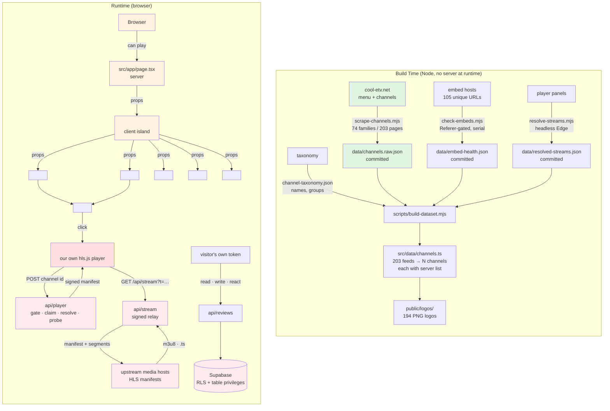

# ACUM — Romanian Live TV, No Ads

[](https://github.com/collaby-org/acum/actions/workflows/ci.yml)


---

## 1. What is ACUM

**ACUM** — Romanian live TV streaming platform. No ads. Free tier: 120 minutes daily. Paid plans remove the limit.

A Netflix-style directory of Romanian live TV channels, built from public embed addresses published by Romanian TV directories.

### Key Features

- **One click to play.** Click a channel — video starts. No poster, no "click to start", no two-click tour.
- **Own player.** Not the upstream's chrome — our own HLS engine, the controls inside the frame, the connection chip, the quality cluster, a live indicator, picture-in-picture and fullscreen.
- **Zero ads.** The upstream's own player page is never served and no third-party script is ever loaded: the browser plays a manifest our server resolves, and every byte travels under a signed token through `/api/stream`.
- **One entry per channel.** The source lists the same broadcaster on multiple servers ("Antena 1 S1", "Antena 1 S2 HD", "Antena 1 S3"). ACUM folds them into one channel with a server list, and when one feed dies it falls back to the next automatically.
- **Find anything, fast.** Ranked search, diacritic-insensitive, and A→Z jump bar.
- **Free tier: 120 minutes daily.** Create an account, watch 2 hours free every day. Paid plans remove the limit.
- **The programme leads.** On a channel page the visitor sees what is on right now — title, its clock range, its own description — before the channel's own text, and the guide says so honestly when there is nothing to show.
- **A lived-in catalogue.** A review is a star rating and a written comment on the programme airing now. The visitor sees their own review — on the channel surface, not only on the homepage — and can change and delete it; like, love and clap carry counters that come from the database, not from a guess.
- **Installable.** PWA with offline shell, real icons and safe-area chrome — behaves like an app on phone.
- **A television app too.** The same catalogue, the same guide, the same badges, the same review engine, driven by a remote.
- **No analytics, no trackers, no ad scripts of our own.** Interface says "no ads" because it's true.

---

## 2. Architecture (Data Flow)



The rule the picture carries: **the browser never names an upstream address.**
It asks for a channel, the server resolves the feeds from the committed
catalogue, and every byte afterwards travels under a signed token through
`/api/stream`.

- The full diagram, in the brand's own palette:
  [`docs/diagrams/stream-path.html`](docs/diagrams/stream-path.html)
- The same three paths (stream, session, phone navigation) in Mermaid:
  [`docs/diagrams/stream-path.md`](docs/diagrams/stream-path.md)

---

## 3. Technology Stack

| Layer | Technology | Version | Role |
|-------|-----------|---------|------|
| Framework | Next.js | 16.4.5 | App Router, Turbopack |
| Interface | React | 19.3.1 | Server components + client islands |
| Styling | Tailwind CSS | 4.3.4 | Design tokens, utilities |
| Types | TypeScript | 5.9.3 | Strict type safety |
| Icons | Lucide React | 1.67.0 | Lucide icons only |
| Player | hls.js | 1.7.4 | HLS streams, failover |
| Base UI | shadcn/ui | — | Primitive components |
| Fonts | Space Grotesk + Inter | — | Self-hosted, no CDN |
| Data | Supabase (Auth + Postgres) | — | Accounts, plans, limits, reviews, counters |
| Payments | Stripe | — | Checkout and the webhook |

The television app (`monorepo/tv/`) runs its own installed copy of the same
stack, one step behind: Next 16.4.2, React 19.3.0, ESLint 9.

---

## 4. Pricing & Plans

| Plan | Price | Daily Limit | Streams | Seats |
|------|-------|-------------|---------|-------|
| **Free** | Free | 120 min/day | 1 | 1 |
| **Individual** | 3.99 RON/month | Unlimited | 2 | 1 |
| **Household** | 5.99 RON/month | Unlimited | 4 | 4 |
| **Lifetime** | One-time | Unlimited | 4 | 4 |

---

## 5. How to Run

```bash
# 1. Clone
git clone https://github.com/collaby-org/acum.git
cd acum

# 2. Dependencies
npm install

# 3. Environment variables (only if you want Admin/desk)
cp .env.example .env   # fill: SUPABASE_URL, SUPABASE_ANON_KEY, etc.

# 4. Development
npm run dev            # http://localhost:3000

# 5. Checks
npm run lint           # ESLint (flat config)
npm run typecheck      # next typegen && tsc --noEmit
npm run build          # Turbopack production build
```

### Verification

The proof is a set of headless harnesses that ask the deployed site the
questions the bugs were about. They need the harness credentials in the
environment (never in a `.env` file — the repository must not carry secrets).

```bash
export NEXT_PUBLIC_SUPABASE_URL='…'
export NEXT_PUBLIC_SUPABASE_ANON_KEY='…'
export ACUM_HARNESS_EMAIL='…'
export ACUM_HARNESS_PASSWORD='…'

npm run verify:live          # 11 questions about the live site
npm run verify:player        # one click → moving picture, no popup, no ad host
npm run verify:player:bar    # the bar: one line, one size, 44px targets
npm run verify:ui            # walk the app, fail on a console error
npm run verify:mobile        # the phone: the channel page and the bottom bar
npm run verify:mobile:stream # the playhead on a throttled line
npm run verify:mobile:nav    # the bottom bar: is the tap eaten? how slow?
npm run verify:acum          # the catalogue and the guide, against the live site
npm run verify:fallback      # the failover chain, when a feed dies
```

Every number these harnesses produced is written down in
[`docs/verification.md`](docs/verification.md).

---

## 6. How the Catalog is Built

The pipeline runs at build time, with no external dependencies at runtime:

```bash
npm run data:scrape    # cool-etv.net  → data/channels.raw.json
npm run data:probe     # liveness probe  → data/embed-health.json
npm run data:resolve   # Edge headless, HLS URLs → data/resolved-streams.json
npm run data:build     # merge + logos   → src/data/channels.ts
npm run data:epg       # the programme guide → data/epg.json
```

`scripts/channel-taxonomy.json` is the editorial layer: the source obfuscates labels (`HB0 R0` = HBO, `Ant 1` = Antena 1, `L00K Tv` = LOOK TV), so each family and feed gets a corrected Romanian display name and category.

`src/data/channels.ts` is generated — **do not edit by hand**.

---

## 7. The Referer Gate (Why the Proxy Exists)

Upstream media hosts sit behind a Cloudflare `Referer` allowlist. With the correct referer they serve a real player; with any other they answer `301 → google.com`. A browser cannot set a `Referer`, so the stream is relayed through `/api/stream`. Full measurement is in [docs/specs/player-architecture.md](docs/specs/player-architecture.md).

---

## 8. Pages and Routes

| Route | Purpose |
|-------|---------|
| `/` | Hero + rails + grid + the popular reviews (homepage) |
| `/canale` | The catalogue |
| `/canale/[categorie]` | Channel by category |
| `/canale/toate` | All channels (full directory) |
| `/canale/grupate` | All channels, grouped by family |
| `/canal/[id]` | Channel page (the programme first, then the player) |
| `/ghid` | Interactive TV guide |
| `/azi` | Today's program |
| `/maine` | Tomorrow's program |
| `/saptamana` | The week |
| `/cauta-o-emisiune` | Search the guide |
| `/top-emisiuni` | The most watched programmes |
| `/trending` | What's trending now |
| `/preturi` | Subscriptions (your plan if signed in) |
| `/conturi` | Sign in / account |
| `/admin` | The desk |
| `/tv` | TV-native page (Netflix-style, remote-first, QR login) |

---

## 9. Installation (PWA — Mobile Only)

ACUM is a PWA **for mobile phones only**:

- Open in your phone browser
- Browser menu → "Install application" / "Add to home screen"
- Opens as a native app, without browser chrome
- **TV app is a separate native app** (`monorepo/tv/`) deployed separately on Vercel

---

## 10. Documentation

| Document | Contents |
|----------|----------|
| [docs/project-doc.md](docs/project-doc.md) | What the project is and how it's built |
| [docs/system_diagram.md](docs/system_diagram.md) | Architecture (diagrams) |
| [docs/diagrams/stream-path.md](docs/diagrams/stream-path.md) | The stream, session and phone-navigation paths |
| [docs/diagrams/stream-path.html](docs/diagrams/stream-path.html) | The stream path, in the brand's own palette |
| [docs/work-log.md](docs/work-log.md) | This delivery wave: what was asked, what was done, what it measured |
| [docs/verification.md](docs/verification.md) | Every command, every output, before and after |
| [docs/backlog.md](docs/backlog.md) | What is open, mapped to the GitHub issues |
| [docs/tech_stack.md](docs/tech_stack.md) | Pinned versions |
| [docs/targets.md](docs/targets.md) | Scope and quality bar |
| [docs/roadmap.md](docs/roadmap.md) | What's next |
| [docs/changelog.md](docs/changelog.md) | Release history |
| [docs/specs/catalogue-model.md](docs/specs/catalogue-model.md) | Why one entry per channel |
| [docs/specs/player-architecture.md](docs/specs/player-architecture.md) | How the player works |
| [design-system/DESIGN_SYSTEM.md](design-system/DESIGN_SYSTEM.md) | Tokens, components, motion |
| [AGENTS.md](AGENTS.md) | Contract for agents and contributors |
| [CONTRIBUTING.md](CONTRIBUTING.md) | How to contribute |

The delivery wave is also tracked as a living issue:
[#22 — the delivery log](https://github.com/collaby-org/acum/issues/22).

---

## 11. Contributing

Every change goes through a pull request. The PR template asks for evidence and `version: before → after`.

Rules:
- **Lucide icons only** (no emoji in UI)
- **Romanian copy**, serious, no emoji
- **`.env` only via env tools**, never in git
- **PWA only** (no APK / store)
- **Desktop / mobile untouched by `/tv`**

---

## 12. Security

See the [security policy](.github/SECURITY.md).  
Report vulnerabilities privately via [GitHub's security advisory form](https://github.com/collaby-org/acum/security/advisories/new).

---

## 13. License

MIT — see [LICENSE](LICENSE).

The channels belong to their respective owners. ACUM indexes public embed addresses published by the source and links back to them.

---

> **ACUM** — Now is now. No ads. 120 minutes free daily. Paid plans unlimited.
