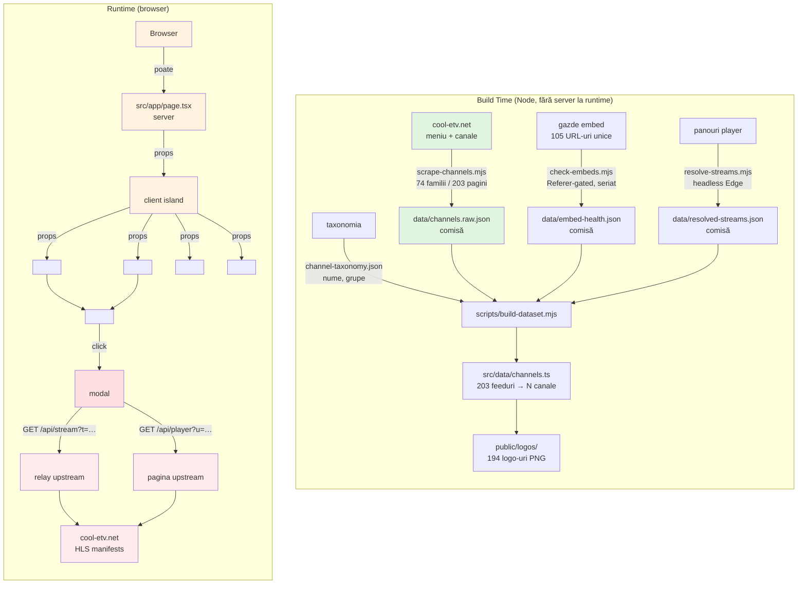

# ACUM — TV Live Română, Fără Reclame, Fără Cont

[](https://github.com/collaby-org/acum/actions/workflows/ci.yml)


**ACUM — Televiziune live românească, fără reclame și fără cont.**  
O direcție de canale TV live în stilul Netflix, construită din adresele publice de embed ale canalelor românești.

---

## 2. Ce este ACUM

```
┌──────────────────────────────────────────────────────────────────────────────┐
│                        📺 ACUM — TV LIVE ROMÂNESC                            │
├──────────────────────────────────────────────────────────────────────────────┤
│                                                                              │
│   ┌──────────────┐  ┌──────────────┐  ┌──────────────┐  ┌──────────────┐   │
│   │   🎬 HERO    │  │   📡 LIVE    │  │   🔍 CAUTĂ   │  │   ❤️ FAVORIT   │   │
│   │   (Acum la   │  │   CANALE     │  │   (canale,   │  │   (favorite    │   │
│   │    TV)       │  │   (sticky)   │  │   categorii) │  │   recente)     │   │
│   └──────────────┘  └──────────────┘  └──────────────┘  └──────────────┘   │
│                                                                              │
│   ┌─────────────────────────────────────────────────────────────────────┐   │
    │                    PLAYER: 0 reclame, 0 popupuri, 0 tracking      │
    │   HLS stream → proxy propriu → video direct, fără ad-uri          │
    └─────────────────────────────────────────────────────────────────────┘   │
│                                                                              │
│   🇷🇴 Română  •  📱 Responsive  •  📺 PWA (instalabil)                    │
│   ⚡ Sub-șoaptă  •  🔒 Fără cont  •  🚫 Zero reclame                     │
└─────────────────────────────────────────────────────────────────────────────┘
```

### Caracteristici cheie

- **Un click și vezi.** Apasă pe un canal — imaginea pornește. Fără poster, fără "click to start", fără tour de două ecrane.
- **Player propriu.** Nu e chrome-ul sursei. Scrubber live-edge-locked, volum, Picture-in-Picture, fullscreen, indicator de "LIVE" care respira.
- **Zero reclame.** Sursele sursă apelează `aclib.runPop()`, care arunge reclame în ferestre noi. ACUM servește pagina sursă cu toate scripturile de reclamă și următoare eliminate, sub un `sandbox` CSP, și stream-lează media prin proxy propriu. În logurile de rețea: zero gazde de reclamă, zero popupuri.
- **Un singur intrare pe canal.** Sursa listează același difuzor pe mai multe servere ("Antena 1 S1", "Antena 1 S2 HD", "Antena 1 S3"). ACUM le împarte într-un singur canal cu o listă de servere, și când un feed moare, trece automat la următorul.
- **Găsești orice, repede.** Cautare clasificată, insensibilă la diacritice, și bară A→Z.
- **Niciun cont.** Favoritele și ultimele văzute rămân în `localStorage`.
- **Instalabil.** PWA cu shell offline, icoane reale și chrome de siguranță pentru ecranuri — se comporță ca o aplicație pe telefon și TV.
- **Niciun analytics, niciun tracker, niciun script de reclamă propriu.** Interfața spune "0 reclame" pentru că este adevărat.

---

## 3. Arhitectura (fluxuri de date)



---

## 4. Tehnologie (stivă reală)

| Stratură | Tehnologie | Versiune | Rol |
|----------|-----------|----------|-----|
| Framework | Next.js | 16.4.2 | App Router, Turbopack |
| Interfață | React | 19.3.0 | Client island + server components |
| Stil | Tailwind CSS | 4 | Tokene de design, utilitare |
| Tipare | TypeScript | 5 | Siguranță de tip strict |
| Pictograme | Lucide React | 1.60.0 | Doar pictograme Lucide |
| Player | hls.js | 1.7.3 | Fluxuri HLS, failover |
| Stil bază | shadcn/ui | — | Componente primitive |
| Fonturi | Space Grotesk + Inter | — | Self-hostate, fără CDN |

---

## 5. Cum rulezi

```bash
# 1. Clone
git clone https://github.com/collaby-org/acum.git
cd acum

# 2. Dependențe
npm install

# 3. Variabile de mediu (doar dacă vrei Admin / desk)
cp .env.example .env   # completă: SUPABASE_URL, SUPABASE_ANON_KEY, etc.

# 4. Dezvoltare
npm run dev            # http://localhost:3000

# 5. Verificări
npm run lint           # ESLint (flat config)
npm run typecheck      # next typegen && tsc --noEmit
npm run build          # Turbopack production build

# 6. Verificări runtime
npm run verify:player    # un clic → imagine în mișcare, fără popup, fără gazdă de reclamă
npm run verify:fallback  # omrești primul server → următorul ia relay-ul
npm run verify:ui        # walk the app, capture docs/reviews/
```

---

## 6. Cum e construit catalogul (pipeline)

Pipeline-ul Rulează în build time, fără dependențe externe la runtime:

```bash
npm run data:scrape    # cool-etv.net  → data/channels.raw.json
npm run data:probe     # probă de viață  → data/embed-health.json
npm run data:resolve   # Edge headless, URL-uri HLS → data/resolved-streams.json
npm run data:build     # merge + logo-uri   → src/data/channels.ts
```

`scripts/channel-taxonomy.json` este stratul editorial: sursa obfuscă etichetele (`HB0 R0` = HBO, `Ant 1` = Antena 1, `L00K Tv` = LOOK TV), astfel fiecare familie și feed primește un nume românesc corect și o categorie.

`src/data/channels.ts` este generat — **nu editați cu mâna**.

---

## 7. Portaria Referer (de ce există proxy-ul)

Gazdele media upstream se află în spatele unei liste `Referer` pe Cloudflare. Cu refererul corect servesc un player real; cu orice altul răspund `301 → google.com`. Un browser nu poate seta un `Referer`, deci fluxul este relayat prin `/api/stream`. Măsura completă este în [docs/specs/player-architecture.md](docs/specs/player-architecture.md).

---

## 8. Paginile și rutele

| Rută | Ce face |
|------|---------|
| `/` | Hero + rails + grid (pagina principală) |
| `/canale/[categorie]` | Canal după categorie |
| `/canale/toate` | Toate canalele (director complet) |
| `/canal/[id]` | Pagina propriu-zisă a canalului (panou, live) |
| `/ghid` | Ghidul TV interactiv |
| `/azi` | Programul de astăzi |
| `/maine` | Programul de mâine |
| `/trending` | Ce este popular acum |
| `/preturi` | Abonamente (planul tău dacă ești autentificat) |
| `/conturi` | Autentificare / cont |
| `/admin` | Panoul admin (desk) |

---

## 9. Instalare (PWA)

ACUM este o PWA:

- Deschide în browser pe telefon sau TV
- Meniu browser → "Instalează aplicația" / "Adaugă la ecranul principal"
- Se deschide ca o aplicație nativă, fără bara de browsă
- Pe TV: `/tv` se deschide ca o aplicație nativă (dacă browserul TV suportă instalare)

---

## 10. Documentație

| Document | Ce conține |
|----------|------------|
| [docs/project-doc.md](docs/project-doc.md) | Ce este proiectul și cum e construit |
| [docs/system_diagram.md](docs/system_diagram.md) | Arhitectura (diagrame) |
| [docs/tech_stack.md](docs/tech_stack.md) | Pinerile versiunilor |
| [docs/targets.md](docs/targets.md) | Scop și bară de calitate |
| [docs/roadmap.md](docs/roadmap.md) | Ce urmează |
| [docs/changelog.md](docs/changelog.md) | Istoricul lansărilor |
| [docs/specs/catalogue-model.md](docs/specs/catalogue-model.md) | De ce o singură intrare pe canal |
| [docs/specs/player-architecture.md](docs/specs/player-architecture.md) | Cum funcționează playerul |
| [design-system/DESIGN_SYSTEM.md](design-system/DESIGN_SYSTEM.md) | Tokene, componente, mișcare |
| [AGENTS.md](AGENTS.md) | Contractul pentru agenți și contribuitori |
| [CONTRIBUTING.md](CONTRIBUTING.md) | Cum contributi |

---

## 11. Contribuire

Fiecare modificare trece printr-un pull request. Șablonul PR cere dovezi și `version: before → after`.

Reguli:
- **Lucide doar** pentru pictograme (niciun emoji în interfață)
- **Copie română**, serioasă, fără emoji
- **`.env` numai prin unelte de env**, niciodată în git
- **PWA numai** (fără APK / magazin de aplicații)
- **Desktop / mobil nedevățați de `/tv`**

---

## 12. Securitate

Vezi [politica de securitate](.github/SECURITY.md).  
Rapportezi vulnerabilități privat prin [formularul GitHub](https://github.com/collaby-org/acum/security/advisories/new).

---

## 13. Licență

MIT — vezi [LICENSE](LICENSE).

Canalele aparțin respectivei deținătoare. ACUM indexează adresele publice de embed publicate de sursă și reîntoarce linkuri spre ea.

---

> **ACUM** — acum este acum. Fără reclame. Fără cont. Doar TV.
