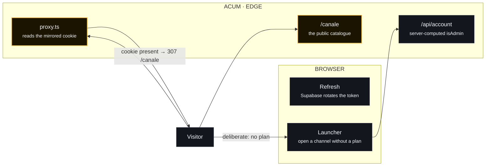
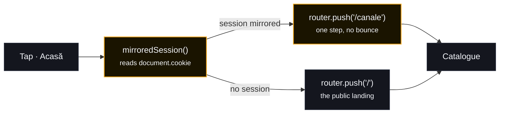

# Diagrams — the paths that were broken

Three paths were reported broken in production. Each one has a diagram here:
the **stream** (the picture and its tokens), the **session** (the redirect loop
at the front door) and the **phone navigation** (the bottom bar that did
nothing).

The brand-accurate graphic of the stream path is
[`stream-path.html`](stream-path.html) — open it in any browser; it is a single
self-contained file with inline SVG, no scripts and no external requests.

---

## 1. The stream path

The browser never names an upstream address. It asks for a **channel**, the
server resolves the feeds from the catalogue, and hands back a **signed
manifest**; every byte afterwards travels through `/api/stream` under a token
that carries the address.

```mermaid
flowchart LR
    subgraph B["BROWSER · PHONE & PWA"]
        P["Player + hls.js<br/><small>video-player.tsx</small>"]
    end

    subgraph S["ACUM · VERCEL"]
        PL["<b>/api/player</b><br/><small>gate · catalogue · probe ≤ 1.2 s</small>"]
        ST["<b>/api/stream</b><br/><small>token proxy · exact host allowlist</small>"]
        C["Catalogue<br/><small>channels.ts · resolved-streams.json</small>"]
    end

    subgraph U["UPSTREAM"]
        H["HLS host<br/><small>manifest · segments</small>"]
    end

    P -- "CANAL ID" --> PL
    PL -- "MANIFEST" -.-> P
    PL -- "FEEDS" --> C
    C -- "SERVERS" -.-> PL
    PL -- "ALLOWLIST" --> C
    P -- "?t=TOKEN" --> ST
    ST == "MANIFEST" ==> H
    H -- "SEGMENTS" -.-> ST
    ST -- "REWRITE" -.-> P

    classDef node fill:#14161e,stroke:#2a3040,color:#f4f6fb,stroke-width:1px;
    classDef focus fill:#1a1400,stroke:#f2a71b,color:#f4f6fb,stroke-width:1.5px;
    classDef store fill:#0d0f16,stroke:#3a4358,color:#f4f6fb,stroke-width:1px;
    class P,H node;
    class PL store;
    class ST focus;
    class C store;
```

The four rules the picture has to carry:

| Rule | Where it lives | What it stops |
| --- | --- | --- |
| The browser names a channel, never an address | `/api/player` | The server being used as an open relay |
| The address travels in a signed token | `lib/stream.ts` | A playlist being fetched by anyone |
| The host allowlist is exact, re-checked per redirect | `lib/stream.ts` | SSRF into the private network |
| The answer carries `no-store` | both routes | A stale or shared manifest |
| The proxy answers inside the live window (5 s) | `app/api/stream/route.ts` | A playlist that takes thirty seconds to arrive |
| A chain that runs out is asked for again, once | `hooks/use-player.ts` | A session that ends on addresses minted minutes earlier |

---

## 2. The session path

The front door used to redirect on the mere *presence* of a cookie, and the
catalogue pages used to gate on the session — which meant a hiccup at the
auth server could throw a visitor onto the accounts page on the way in. Both
are gone. The catalogue is public, the proxy sends a browser that holds a
session to `/canale` (fresh or stale — the refresh token, which the
**browser** owns, is what renews it), and the **server** only ever sees the
access token.



* **The server never touches the refresh token.** Supabase rotates refresh
  tokens and treats a reuse as a possible theft, so the browser keeps it and
  the server keeps the access token alone.
* **`/canale` is public.** The catalogue — the names, the artwork, the guide,
  the audience — does not gate on the session, so nothing about the auth
  server can decide whether a visitor may read it. The way in lives where
  the picture is: `/api/player` checks the account, the plan and the
  allowance.
* **`/conturi` is only ever a deliberate destination.** The only route that
  sends a visitor to the accounts page is the launcher's *"open a channel
  without a plan"* — a choice, not a bounce. `scripts/verify-front-door.mjs`
  prints the whole route chain in three device states (a fresh cookie, a
  stale one, none) and fails if `/conturi` appears in it.
* **The mirrored cookie is not httpOnly.** It has to be readable by the client
  to answer *"is there a session?"* without a round trip. It carries the
  access token only.

---

## 3. The phone navigation path

The bottom bar was missing on the plans page, and "home" pointed at `/`, which
the server then bounced to `/canale` — a redirect round trip that on a phone
reads as *"nothing happened"*.



* The destination is decided **locally**, from the mirrored cookie, before the
  account state has resolved.
* The bar is rendered on the catalogue, on the channel page **and** on the
  plans page — the plans page was the one place a visitor could stand with no
  way back.
* The plan is closed with `MOBILE_NAV_SPACE`, so the last card is never hidden
  behind the bar.
